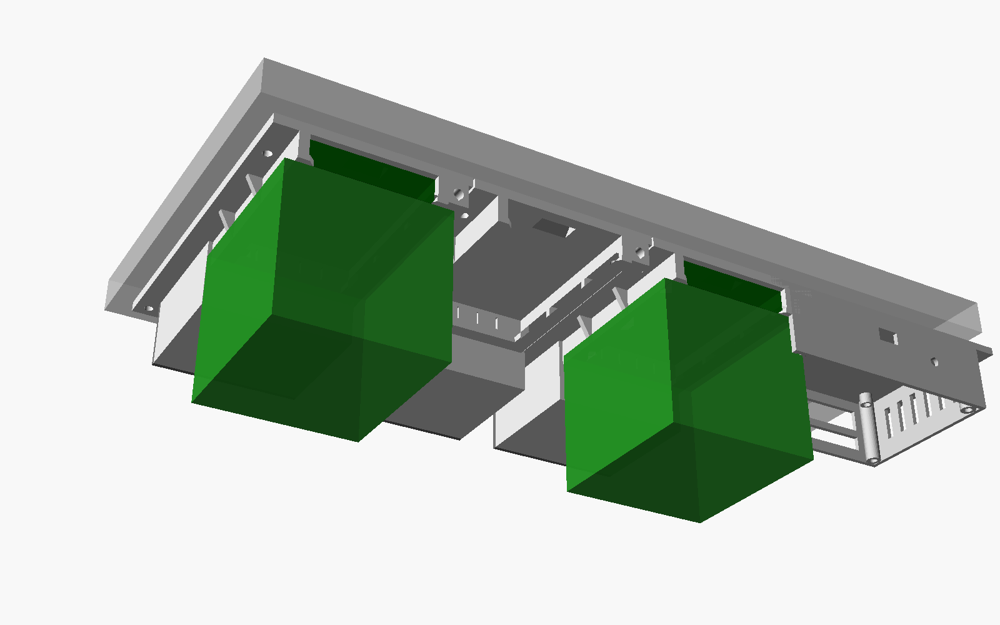

# Parkside X20V 10-slot under-shelf charger (ESP32-C6 / ESPHome)

The rack screws to the underside of a shelf. Ten Parkside X20V packs slide in from the front and
hang from rails, as they do on a tool. Each slot has its **own CC/CV charger IC**. An **ESP32-C6
running ESPHome** controls all of them: it charges to a **battery-friendly level** (92 % "ready",
60 % "storage", 100 % on demand). It reports **presence, charge state, temperature, internal
resistance, estimated capacity, self-discharge and an overall health verdict** for every slot to
Home Assistant.

| | |
|---|---|
| Slots | 10 printed modules, 96 mm pitch (96 cm of shelf), one per battery |
| Charger per slot | LTC4162-L: 5S Li-ion, I²C-programmable 3.81–4.20 V/cell, 0.1–3.2 A, telemetry and battery-resistance measurement |
| Controller | ESP32-C6, 2 × TCA9548A I²C mux (one channel per slot), SHT40 enclosure sensor |
| Power | Mean Well LRS-200-24 (fanless), 8 A battery-side budget shared across the slots |
| Presence | Microswitch per slot, with the pack's NTC/voltage as a fallback |
| Safety | Per-slot fuses on both sides, NTC window 5–45 °C plus JEITA, charge timeout, fault latching, ambient limit, default-off bus switch, **70 °C thermal cut-out in the AC line** |
| Estimated cost | about €360 (~€19 per slot board) |

## Contents

| Path | What |
|---|---|
| `mechanical/parkside_shelf_charger.scad` | Parametric OpenSCAD model: slot module, bay lid, fit-test gauge, controller box |
| `mechanical/stl/` | STLs exported with the **placeholder** rail dimensions. Calibrate first |
| `docs/mechanical.md` | How to measure the pack, the gauge print, printing and mounting |
| `electronics/electronics.md` | Architecture, slot-board and main-board design, pin map, power budget, safety |
| `electronics/bom.csv` | Bill of materials with rough prices |
| `esphome/` | ESPHome config + external component (`parkside_charger`, `parkside_slot`) |
| `esphome/tests/sim/` | Host simulation of the charging logic (fake LTC4162 + battery model) |
| `docs/firmware.md` | Charging strategy, entities, LED legend, health heuristics, bring-up |

## Build order

1. **Check a pack** (electronics.md §2): find B+/B−/T, confirm the NTC is about 10 kΩ, and check
   that the pack charges on B+/B−.
2. **Measure the pack and print the gauge**, then adjust the `.scad` parameters until it fits.
   Print one module.
3. **Build one slot board.** Copy the LTC4162 power stage from the DC2038A demo board, then add
   the PCA9554, fuses and connectors.
4. **Main board + ESPHome**, then bring-up with a lab supply (firmware.md, checklist).
5. Test one complete slot end to end. Then build the other nine.

## Open items you need to verify

- **Rail and contact geometry** of the X20V pack. The model is fully parametric, but its numbers
  are educated placeholders.
- **The LTC4162-L register scaling** in `parkside_charger.h` comes from the datasheet and the
  Linux driver. Before trusting it, compare the voltage and current readings with a meter
  (bring-up step 3).
- The slot-board power stage must follow the datasheet or demo-board layout. This repo specifies
  values and pinout at the functional level, not a finished PCB layout.
