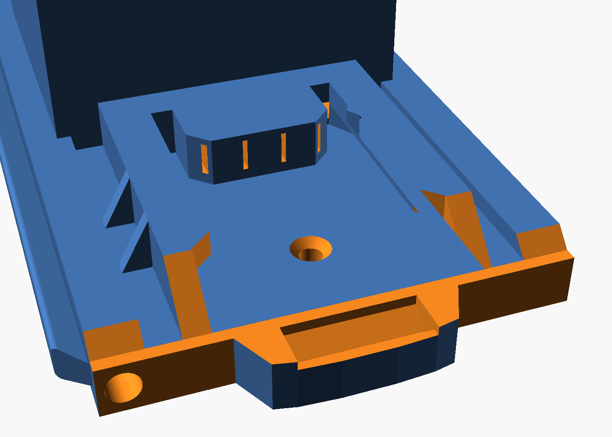
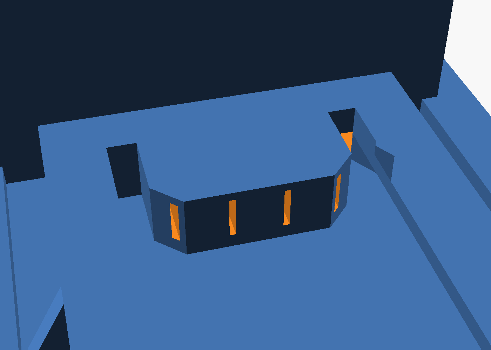
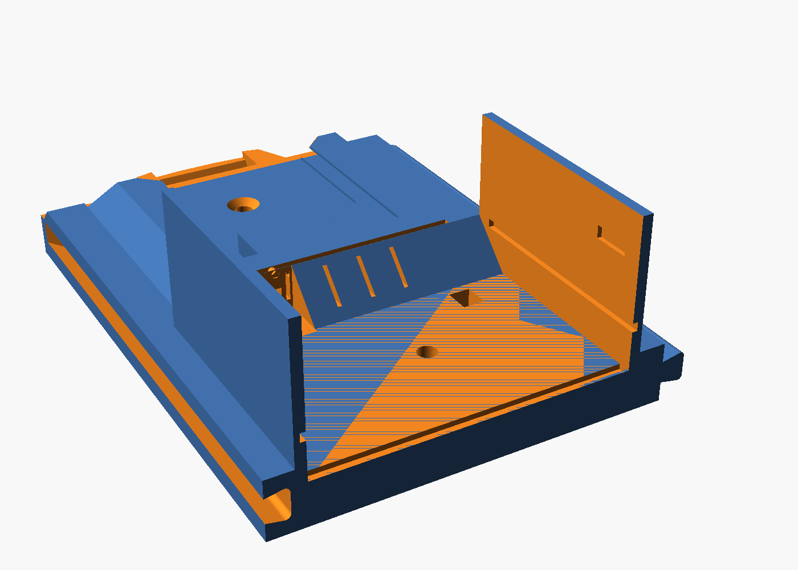
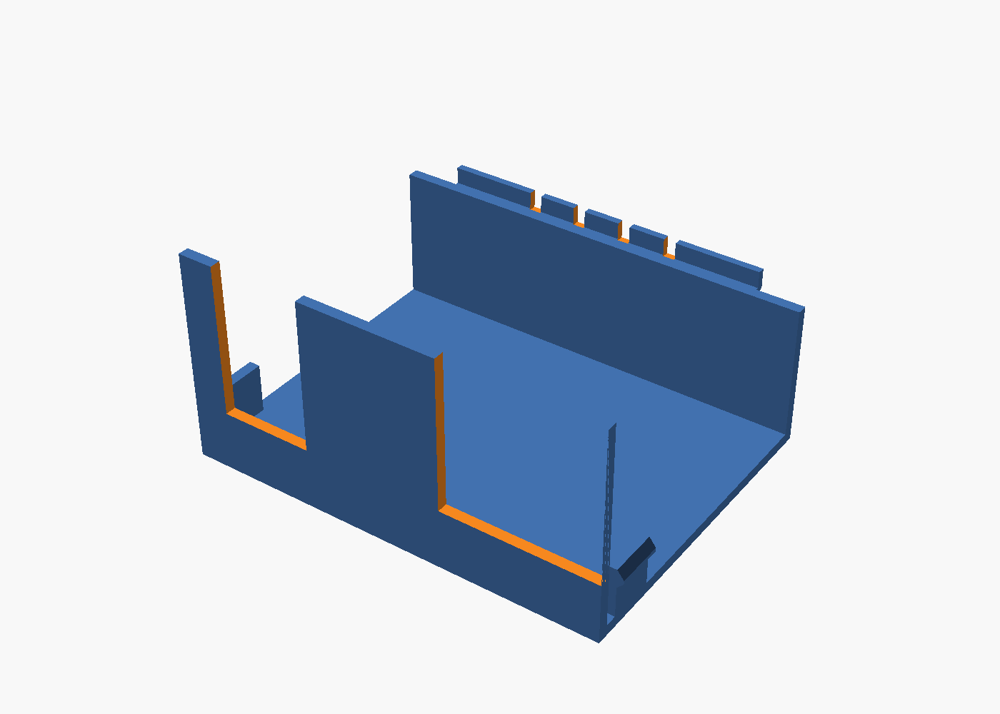
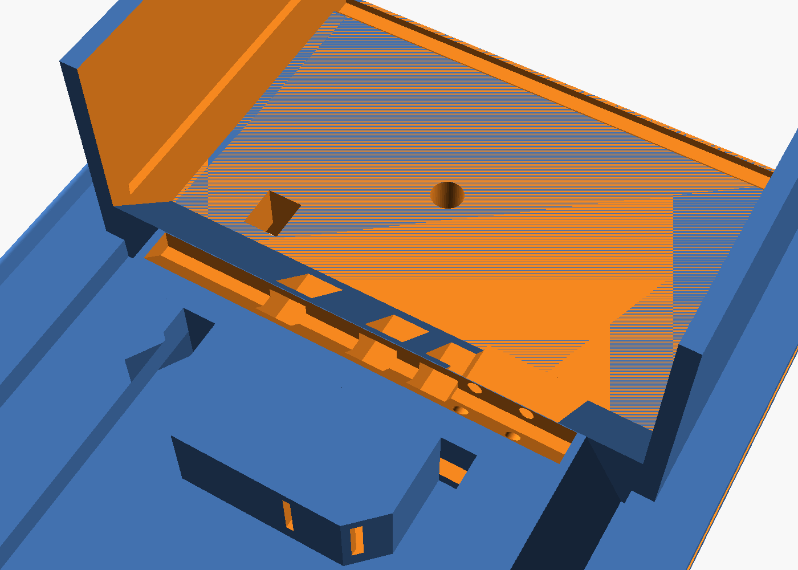
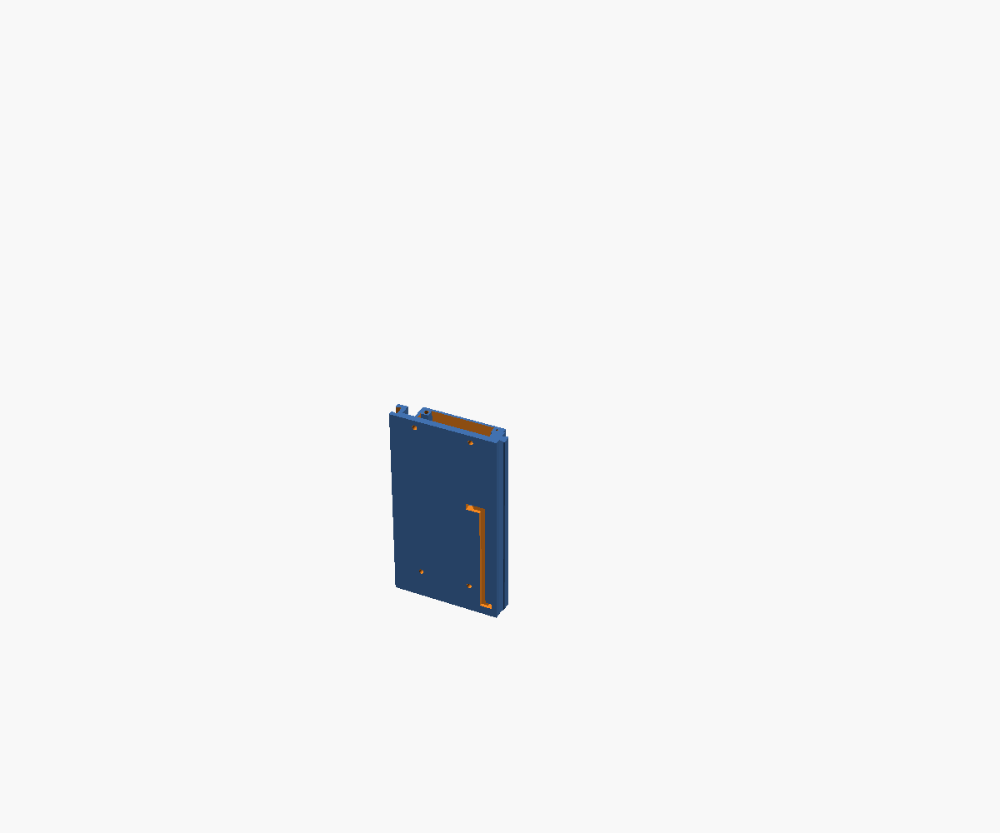
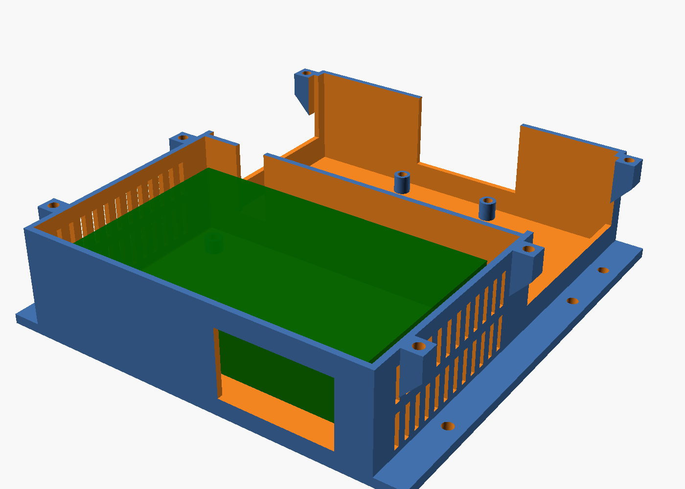
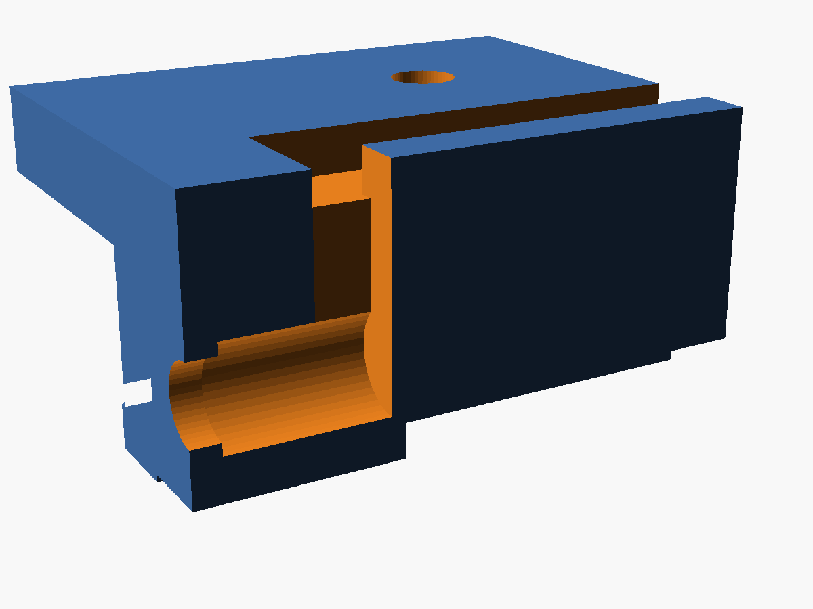

# Mechanical design












## Concept

- **One printed module per battery** (87.6 × 120 mm footprint plus a 9.5 mm nose, 44 mm tall). Modules sit side by
  side at an **88 mm pitch** (86 mm battery + 2 mm; you take the batteries out from below, so no
  finger room is needed): a row of 8 needs **70.4 cm** of shelf. The controller drives up to 16 slots
  through two 24 V outputs, for example **two rows of 8** on two shelves, one chain each.
- **Neighbouring modules slot into each other** with a **sliding dovetail** that runs along the
  full length of each side. Every module has a tongue on its right edge and a groove on its left
  edge. The groove is closed for the first 3 mm at the front, so a module slid onto its neighbour
  stops with its front edge flush. This locks the row sideways and in height, and keeps every
  rail exactly parallel. Each layer of the print contains the full dovetail profile (front face on
  the bed), so it prints strong and without support. The tongue's front end and the groove's
  closed end are both **bevelled at 45°, rising towards the back**, so neither has a flat
  overhang. The bevels also form the front stop: a full contact face, not just an edge. The
  tongue's edges are **rounded** (`jt_r` = 1 mm), and the groove follows with r + clearance, so
  the joint slides smoothly and doesn't catch on elephant's foot or blobs.
- The battery **slides in from the front and hangs from two rails**, as it does on a tool. The
  front end copies the reference holder: the pack only has grooves over the last ~29 mm before
  the contact face, so the **lips start there** (45° lead-in). In front of that the pack rises: the
  rail walls and edge bars **slope away at 45°**, and the frame's front edge sits 45.5 mm in front
  of the contact face. Only a **nose** (41 mm wide, tapering to ~25 mm) reaches 9.5 mm further
  forward over the latch. The pack's latch clicks into the **pocket in the nose** (25 mm wide,
  5 mm deep, open at the tip). Press the release button to pull the pack out.
- The pack's tongue does **not end square**: two prongs, one on each side of the contact pocket,
  reach 14 mm past the contact face, and the wide part above the grooves tapers to the groove
  width over the last 7 mm. The channel follows that shape (taken from a reference holder model).
  A **contact block** (29.6 mm wide, 45° chamfered front corners) fills the pocket between the
  prongs and **holds the contact tabs**. The prong tips stop against the **end wall**, which holds
  the **presence microswitch**: its lever pokes into the left prong pocket. Behind it, an **electronics bay** holds the slot PCB in card guides. The board's
  components face down. The printed frame has only the side walls and the plate: the bay is
  open at the bottom and at the rear, and a **clip-on U-shaped cover** closes front, bottom and
  back (see *Cabling*). Behind the end wall there is a **45° bevel** (the contact slots go
  through it, and the microswitch sits in a pocket in it), so the module prints **standing on
  its rear face without any support**.
- A **5 mm RGB LED** sits in the **front face of the right edge bar**, inside the 10 mm plate
  (outside the area the pack rises into), and is inserted **from the front**. A 6.3 mm
  counterbore, 8.6 mm deep, takes the LED body, so the dome ends **flush** with the front face.
  Its 5.8 mm flange stops on a 5.0 mm lip. Behind the lip, a 7 mm bore holds the solder joints.
  The wires go up into a 5 × 3 mm groove on the shelf side of the plate, back to the bay.
  These are plain round holes: printed face-down they are vertical, so they don't need a teardrop
  shape.

  **Fitting the LED:**
  1. Push the 4 wires from the bay along the groove and down the channel.
  2. Bring them out through the LED hole in the front face.
  3. Trim the LED leads to about 5 mm. Solder the wires and cover each joint with 1.5 mm
     heat-shrink.
  4. Pull the wires back from the groove side and press the LED in until the flange seats. A drop
     of hot glue or CA glue holds it.

  
- A separate **controller box** holds the ESP32-C6 main board and, in its own closed mains
  compartment, the **Mean Well LOP-400-24** (or LOP-300-24) open-frame PSU (`psu` parameter;
  `psu = "none"` gives the old board-only tray). Mount it at least 5 cm away from the batteries.

## Measured so far (Parkside X20V)

| Measurement | Value | Model parameter |
|---|---|---|
| Tongue width (above the grooves) | 46.3 mm | `chan_w` = 46.9 |
| Groove depth / height | 4.5 / 5.4 mm | `lip_in` = 4.2, `lip_t` = 5.0 |
| Tongue top → groove | 4.8 mm | `lip_gap` = 5.1 |
| Battery body width | 86 mm | `pitch` = 88 |
| Rail length | 64 mm, tongue end (release button) to the contact face | `rail_len` = 64 |
| Latch tooth | Measured: 4 mm from the tongue end, 29 mm wide, 4 mm long, sticks up about as far as the top surface (4–5 mm) | The pocket copies the reference holder: `latch_w` = 25, profile `latch_prof` (5 mm deep, open at the nose tip) |
| Front end | From the reference holder: lips start 28.6 mm in front of the contact face; walls slope away at 45° and reach the plate face 43 mm in front of it; frame front 45.5 mm, nose tip 55 mm in front of it | `lip_l`, `lead_in`, `slope_l`, `front_l`, `nose_l`, `nose_w` |
| Tongue end | Prongs beside the contact pocket reach 14 mm past the contact face; pocket 30 mm wide, square (the reference holder had 4 mm chamfers, the original charger a square block); wide part tapers 4 mm over the last 7 mm (from the reference holder model) | `prong_l` = 14, `cblock_w` = 29.6, `cblock_ch` = 0.8, `wing_l` = 7 |
| Battery top surface | 4–5 mm below the tongue top, about as high as the latch tooth. Beside the tongue there is a trough down to below the grooves, at least ±34.9 mm wide (the reference holder fills it) | `body_top` = 4, `trough_x` = 34.9. Inside the trough: rail walls and ribs. Outside it, nothing reaches more than 3.5 mm below the tongue top: the edge bars, dovetail and LED sit in the 10 mm plate (`plate_t` = 10) |
| Contacts | 4 slots at an 8 mm pitch, 9.8 mm deep, 0.8 mm blades fit. Seen from the front (tongue pointing away): **+, ID, T, −**. Tabs for **+, ID and −** only; T is not used | `contact_x` = −12, −4, 4, 12; `contact_used`; `contact_len` = 6.5 (tab: `tab_w`, `tab_t`, `tab_flat`, `ear_w`, `lance_*`, `barrel_w`) |


**Still to measure** (placeholders in the model):
- **Contact height (`contact_z`):** the centre of the contact slots, measured down from the
  tongue top.

## Step 1: measure your battery and calibrate the model

Parkside has not published the rail geometry, and packs differ slightly between generations. The
values in the model come from one measured pack; check them on yours. With calipers, measure:

| Parameter | What to measure on the pack |
|---|---|
| `chan_w` | Width of the raised "tongue" on top of the pack, above the side grooves, **+ 0.6 mm** |
| `lip_in` | Depth of the side grooves (how far the tool's rail goes in), **− 0.3 mm** |
| `lip_t` | Height of the side grooves, **− 0.4 mm** |
| `lip_gap` | Top of the tongue down to the top edge of the groove, **+ 0.3 mm** |
| `rail_len` | Front of the tongue (latch end) to the terminal face |
| `latch_w`, `latch_prof` | Width and depth profile of the latch pocket in the nose |
| `lip_l`, `slope_l`, `front_l`, `nose_l` | Where the grooves start, and where the pack rises at the latch end, measured forward from the contact face |
| `contact_x`, `contact_z` | Centre of each terminal slot: X from the pack's centre line, Z down from the top of the tongue |
| `tab_vertical` | Orientation of the terminal slots |

Then:

1. Print `stl/joint_gauge.stl` (two 20 mm pieces, about 10 min) and slide the tongue piece into
   the groove piece from the open end. It should slide firmly without play. If it binds, raise
   `jt_clear` (default 0.15 mm per side; 0.2 was a bit loose). If it is loose, lower it.
2. Print `stl/gauge.stl` (rear face down, about 20 min): the front 37 mm of the channel with the
   nose, latch pocket, sloped walls and the start of the lips. Slide it onto the pack from the
   front until the lips engage. It should run smoothly without wobbling up and down, nothing may
   touch the raised part of the pack around the latch, and the latch should click into the nose. Adjust, re-render, and repeat.
3. Print `stl/end_gauge.stl`: the last 28 mm of the channel with the contact block, prong
   pockets, end wall and contact slots, printed standing on its rear face. Slide the pack in: the
   prongs must reach the end wall freely, and the contact face must sit against the block. Fit
   two crimped tabs to check that they click in, that they meet the pack's slots (`contact_z`) and
   reach deep enough into them (`contact_len`).
4. Print **one** full slot module and test it with the contacts in place before printing ten.

Export the parts:

```bash
openscad -D 'part="slot"' -o slot.stl parkside_shelf_charger.scad
```

The other parts work the same way: `slot_cover`, `gauge`, `end_gauge`, `joint_gauge`, `controller`,
`controller_lid`. Use `part="assembly"` for a preview, `part="joint_section"` for a cross-section of
the joint, and `part="joint_check"`, which must render empty, to confirm neighbours don't collide.
For the end modules, add `-D joint_left=false` (leftmost, no groove) or `-D joint_right=false`
(rightmost, no tongue that sticks out).

## Printing

| Part | Qty | Orientation | Notes |
|---|---|---|---|
| `slot.stl` | 6 per row of 8 | **Rear face on the bed** (as exported) | **No supports.** Every layer contains the full rail and dovetail profile, so the lips that carry the battery are as strong as possible. Small spots to expect: the 14 mm bridge over the switch pocket, and the 3 mm, 53° catch face of the latch pocket. Use a brim, 4 walls, 30–40 % gyroid, 0.2 mm layers |
| `slot_end_left.stl` | 1 per row | same | Leftmost module (no groove). Optional: a normal `slot.stl` works too |
| `slot_end_right.stl` | 1 per row | same | Rightmost module (no protruding tongue). Optional |
| `joint_gauge.stl` | 1 | as exported | Tests the dovetail fit |
| `gauge.stl`, `end_gauge.stl` | 1 each | as exported (rear face down) | Test the front end + latch, and the channel end + contacts |
| `slot_cover.stl` | 1 per slot | floor on the bed (as exported) | Clip-on bay cover. Print it in **PETG (V-0)**: the spring tabs need its flexibility |
| `controller.stl` | 1 | open side up | All cable notches open to the top, so no support is needed (the gland hole is a short bridge). Print the box with the PSU in **ASA, PC or flame-retardant (V-0) PETG**: the PSU's heatsinks get warm |
| `controller_lid.stl` | 1 | flat | |

**Material: PETG or ASA** (PC-FR if you can). Do **not** use PLA: it creeps under the constant
1 kg load and softens near 55 °C.

## Hardware per slot module

| Qty | Part |
|---|---|
| 1 | Wood screw **4 × 25 mm countersunk (flat head)**, front, in the centre of the channel ceiling. The head sits 0.4 mm below the surface so the battery slides over it |
| 1 | Wood screw **4 × 25 mm pan head**, at the rear, inside the bay above the PCB: drive it from below (cover off) through the 10 mm hole in the slot PCB. The plate is 10 mm thick, leaving 15 mm in an 18 mm shelf. The screw must stay at least 2 mm shorter than plate + shelf |
| 3 | **Contact tabs:** 6.3 mm (FASTON 250) male crimp tabs with a **locking lance** (the housing-lock type: a springy tongue punched out of the blade near its root), uninsulated, one each for +, ID and − (the T contact stays empty). Crimp each onto about 15 cm of **0.75 mm² (18 AWG) silicone wire** (red for +, black for −, any colour for ID) with an open-barrel crimper. Before the slot board goes in, push each tab **tip first from the bay side** into its pocket, with the barrel and the lance facing the **middle** of the block, until it clicks: the side ears then sit on the taper and the lance has sprung out behind a ledge, so the tab can move neither way. It sticks out of the contact face by about 6.5 mm (`contact_len`). A drop of epoxy is optional. Once clicked in, a tab only comes out by force, so try the fit on the end gauge first. The pockets are sized for tabs 6.2 × 0.7 mm, 14 mm from the tip to the ears (`tab_flat`), lance from 9 to 13 mm (`lance_root`, `lance_end`), standing 2 mm off the blade (`lance_h`), ears 8 mm across (`ear_w`): measure yours and adjust. |
| 1 | Microswitch Omron D2F-01L (or SS-5GL with lever) + 2 × M2 × 8 self-tapping screws |
| 1 | 5 mm (T-1¾) RGB LED, **common cathode**, diffused, e.g. Kingbright L-154A4SUREQBFZGEW. Any standard 5 mm LED with a 5.8 mm flange fits. 4-wire cable to the slot PCB |
| 1 | Slot PCB 72 × 47.5 mm (slides into the card guides from the rear) |

## Mounting

1. Shelf thickness: at least 16 mm of solid wood or chipboard. Eight 8 Ah packs weigh about 9 kg.
   Use 2 screws per module, one front and one rear, both on the centre line. The dovetail joint
   carries the sideways and twisting loads between neighbouring modules.
2. For fire protection on wooden shelves, first screw a 0.5–1 mm steel or aluminium sheet to the
   underside of the shelf, then mount the modules through it.
3. Mount the modules **from left to right**, one at a time:
   1. Screw the first (leftmost) module in place, square to the front edge of the shelf.
   2. Put the next module against the shelf underside about 20 cm further forward. Engage its
      groove (left edge, open at the rear) with the tongue of the module already mounted, and
      push it backwards until it stops. Its front edge is now flush.
   3. Drive its 2 screws: the countersunk one in the channel, and the pan-head one inside the bay,
      from below through the hole in the slot PCB (this works with the PCB fitted; the bay cover
      goes on afterwards).
   4. Repeat for the rest of the row. The 0.4 mm gap between the plates is intended.

   This requires about 20 cm of free space in front of the shelf edge, as you slide each module
   on. To replace a module later, unscrew it and slide it out to the front.
4. Wire it up (next section).

## Cabling: everything plugs in with the enclosures closed

No cable has to be threaded through a part before it is connected.

**Slot module.** The slot board's connectors all face down.
- **Open bay:** without its cover the bay is open at the bottom and the rear. You reach the
  **24 V IN (J1) / OUT (J6)** XT30s at the rear edge and the **JST-XH I²C plug (J2)** from below.
- **Clip-on cover** (front face, floor and back face in one U-shaped part, no screws):
  1. Plug in all cables.
  2. Put the cover's front **tongue** up into the slot under the end wall (it has gaps where the
     contact tabs' pockets pass).
  3. Swing the rear of the cover up. The cables drop into the two **cut-outs in the back face,
     which are open at the top** (left: 24 V IN/OUT, right: I²C).
  4. Push until the two **spring tabs** near the rear corners click into the grooves in the side
     walls. The back face's top edge sits in a groove in the plate, and the back face keeps the
     board in its card guides.

  To take it off, push the two tabs inwards (through the cable cut-outs) and swing the rear down.
- **Internal wiring:** the battery contacts, microswitch and LED connect to the front of the
  board (J3/J4/J5). Wire these once, before you slide the board in.

**Daisy chain:**
- Each slot's 24 V OUT (J6, XT30 female) goes to the next slot's IN (J1, XT30 male) with a short
  cable: a pre-made XT30 male-female extension, 16 AWG, 20 cm (about 8 cm of free wire is needed; tuck the slack behind the module). XT30s
  are polarised and gendered, so a cable can't be plugged in reversed or OUT to OUT. The XT30s
  stick out of the board's rear edge into the cover's left cable cut-out.
- The controller's OUT A feeds the first slot of row 1, and OUT B the first slot of row 2.
- One JST-XH 4-pin cable per slot runs to the controller, wired 1:1 (5V, GND, SDA, SCL). Run them
  in a cable duct along the rear.

**Controller box** (148 × 204 × 50 mm with the LOP-400). Two compartments:
- **Low-voltage side:** the board sits on 4 standoffs with its components facing the lid. Its
  walls have U-notches **open towards the lid**:
  - left and right walls: slot cables 1–8 and 9–16, and OUT A / OUT B. Those leave the board's
    bottom edge, run along the 12 mm cable channel behind it and out at the side (row 1 left,
    row 2 right)
  - top wall: the ESP32's USB-C, plus the SHT21, Qwiic and expansion cables
- **Mains side**, behind a closed partition: the PSU on four 6 mm M3 standoffs (heat-set inserts),
  a 20.5 mm hole for an **M20 cable gland** in the rear wall (`mains_entry = "gland"`), and 2.5 mm
  vent slots in both side walls. The lid carries a **90/92 mm fan** over the PSU (`psu_fan`, finger-safe
  grille, M4 × 30 screws and nuts, a slot for its plug into the low-voltage side) and the
  **power LED** (`power_led`, Lumex SSI-LXMP059ID snap-in, cut-out `led_cut` 6.6 × 4.6 mm, lid
  thinned to `led_panel_t` = 1.6 mm around it: check both against your part). The charger is **hard-wired**: 3-core flex from a
  switched fused spur (3 A fuse) comes in through the gland, which clamps it. Use **round**
  cable (flat twin & earth doesn't seal or clamp properly in a round gland; M20 grips 6-12 mm). A 25 mm wiring bay (`mains_bay`) between the PSU and the rear wall
  holds the gland nut, the flex bend, the Wagos and the KSD301. (`mains_entry = "iec"`
  gives the cut-out for a 50 mm snap-in IEC C14 inlet with switch and fuse instead: 47.2 × 28.1 mm,
  wall thinned to `iec_panel_t` = 2 mm around it.) The PSU's 24 V leads
  pass the partition through one small notch next to its output terminals, to J1 (a 6-pin JST VH plug).
  - **L and N:** three **Wago 221** lever connectors: cable L → KSD301 → PSU L, and cable N → PSU N.
    The PSU side is a JST VHR-3 plug on its AC input (pin 1 L, pin 3 N) with short leads.
  - **PE:** the cable's earth (sleeved green/yellow if it is bare) into a fourth Wago, and from there
    a short stranded green/yellow lead with a crimped ring lug to the PSU's earth-marked mounting
    hole (under that screw, with a star washer). The datasheet requires it for class I. Leave the
    earth a little longer than L and N, so it is the last to tear off.
  - **Thermal cut-out** (KSD301, 70 °C, NC) in the L line, fixed with a cable tie or
    high-temperature adhesive against the PSU's heatsink; insulating sleeves on its terminals.
  - All mains wiring stays in this compartment. Solid or stranded ends go straight into the
    Wagos, no ferrules needed. The Wagos lie in the
    wiring bay behind the PSU.

Plug everything in, lay the cables into the notches, then screw the lid on through the six outer
ears (corners plus a pair at the partition). The ears sit at the four corners, outside the notches, each on a 45° gusset, so the box
prints base down without support. Mount the box with its base against the shelf, like the slot
modules.
