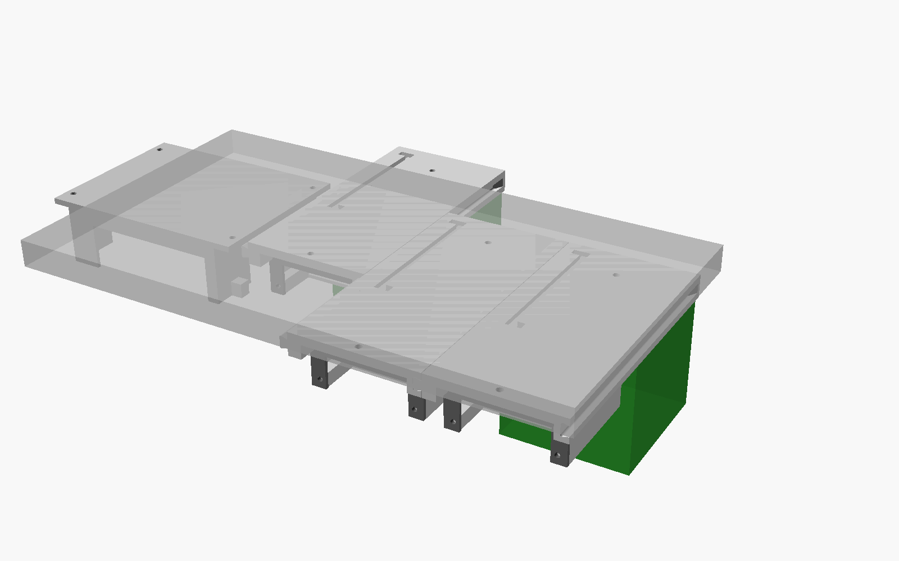
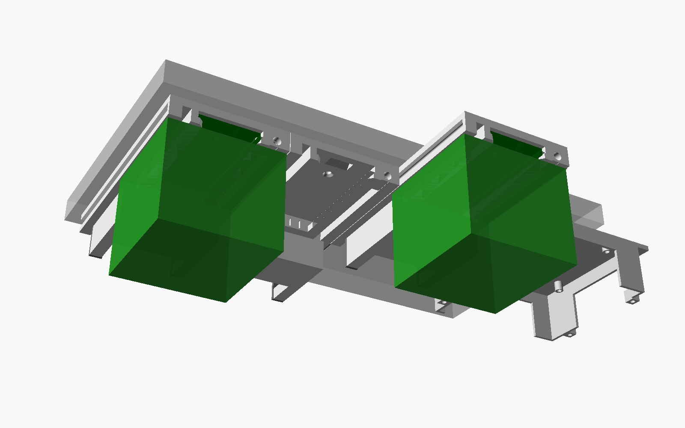
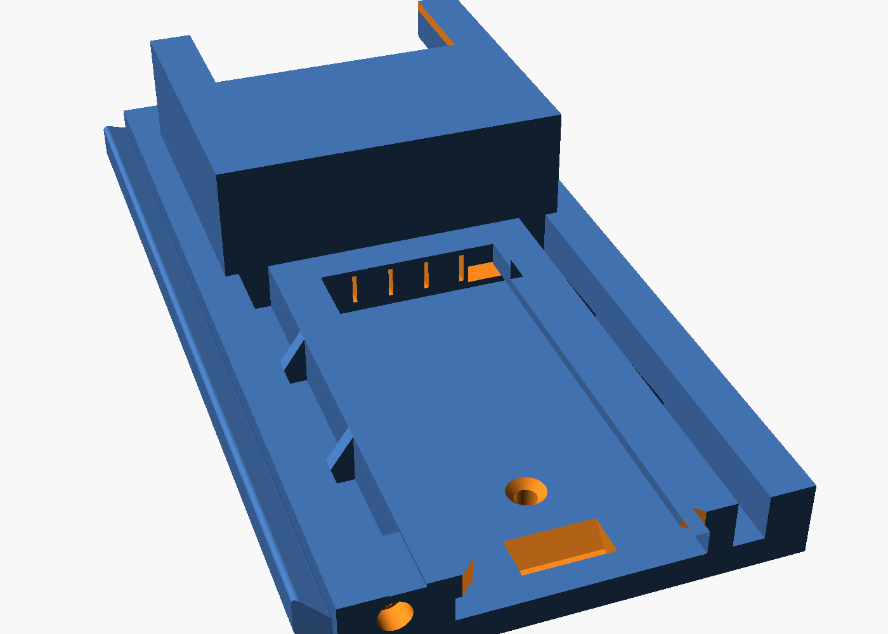

# Mechanical design






## Concept

- **One printed module per battery** (87.6 × 181 mm footprint, 34 mm tall). Modules sit side by
  side at an **88 mm pitch** (86 mm battery + 2 mm; you take the batteries out from below, so no
  finger room is needed): a row of 8 needs **70.4 cm** of shelf. The controller drives up to 16 slots
  through two 24 V outputs, for example **two rows of 8** on two shelves, one chain each.
- **Neighbouring modules slot into each other** with a **sliding dovetail** that runs along the
  full length of each side. Every module has a tongue on its right edge and a groove on its left
  edge. The groove is closed for the first 3 mm at the front, so a module slid onto its neighbour
  stops with its front edge flush. This locks the row sideways and in height, and keeps every
  rail exactly parallel. Each layer of the print contains the full dovetail profile (front face on
  the bed), so it prints strong and without support. The tongue's front end and the groove's
  closed end are both **bevelled at 45°, rising towards the back**, so neither has a flat
  overhang. The bevels also form the front stop: a full contact face, not just an edge. The
  tongue's edges are **rounded** (`jt_r` = 1 mm), and the groove follows with r + clearance, so
  the joint slides smoothly and doesn't catch on elephant's foot or blobs.
- The battery **slides in from the front and hangs from two rails**, as it does on a tool. Its
  own latch clicks into the recess in the channel ceiling. Press the release button to pull it out.
- At the end of the rails, the **end stop holds the contact tabs** and the **presence
  microswitch**. Behind it, an **electronics bay** holds the slot PCB in card guides. The board's
  components face down.
- A **5 mm RGB LED** sits in the front bezel and is inserted **from the front**. A 6.3 mm
  counterbore, 5 mm deep, takes the LED body. Its 5.8 mm flange stops on a 5.0 mm lip, and the
  dome sticks out about 3.5 mm. Behind the lip, a 7 mm bore holds the solder joints. The wires go
  up a 5 × 5 mm channel into a 5 × 3 mm groove on the shelf side of the plate, back to the bay.
  These are plain round holes: printed face-down they are vertical, so they don't need a teardrop
  shape.

  **Fitting the LED:**
  1. Push the 4 wires from the bay along the groove and down the channel.
  2. Bring them out through the front of the bezel.
  3. Trim the LED leads to about 5 mm. Solder the wires and cover each joint with 1.5 mm
     heat-shrink.
  4. Pull the wires back from the groove side and press the LED in until the flange seats. A drop
     of hot glue or CA glue holds it.

  
- A separate **controller box** holds the ESP32-C6 main board. The Mean Well PSU mounts with its
  own screw holes, at least 5 cm away from the batteries.

## Measured so far (Parkside X20V)

| Measurement | Value | Model parameter |
|---|---|---|
| Tongue width (above the grooves) | 46.3 mm | `chan_w` = 46.9 |
| Groove depth / height | 4.5 / 5.4 mm | `lip_in` = 4.2, `lip_t` = 5.0 |
| Tongue top → groove | 4.8 mm | `lip_gap` = 5.1 |
| Battery body width | 86 mm | `pitch` = 88 |
| Contacts | 4 slots at an 8 mm pitch, 9.8 mm deep, 0.8 mm blades fit. Seen from the front (tongue pointing away): **+, ID, nc, −** | `contact_x` = −12, −4, 4, 12; `contact_len` = 8 |


**Still to measure** (placeholders in the model):
- **Rail length (`rail_len`):** along the tongue, from the end with the release button to the face
  with the contact slots.
- **Latch tooth (`latch_y/w/l/d`):** with the tooth extended, measure:
  - its distance from the tongue's end (`latch_y`)
  - its width across the battery (`latch_w`)
  - its length along the battery (`latch_l`)
  - how far it sticks up (`latch_d`)
- **Contact height (`contact_z`):** the centre of the contact slots, measured down from the
  tongue top.
- **Battery top surface:** the height of the surface beside the tongue, measured down from the
  tongue top. The model assumes it starts right below the grooves (10.2 mm), which leaves only
  about 0.4 mm clearance under the rail walls, LED bezel and edge bars.

## Step 1: measure your battery and calibrate the model

The rail geometry in `parkside_shelf_charger.scad` is a **placeholder**. Parkside has not published
it, and packs differ slightly between generations. With calipers, measure:

| Parameter | What to measure on the pack |
|---|---|
| `chan_w` | Width of the raised "tongue" on top of the pack, above the side grooves, **+ 0.6 mm** |
| `lip_in` | Depth of the side grooves (how far the tool's rail goes in), **− 0.3 mm** |
| `lip_t` | Height of the side grooves, **− 0.4 mm** |
| `lip_gap` | Top of the tongue down to the top edge of the groove, **+ 0.3 mm** |
| `rail_len` | Front of the tongue (latch end) to the terminal face |
| `latch_y`, `latch_w`, `latch_l`, `latch_d` | Position and size of the spring latch tooth when it is extended, + 1 mm clearance |
| `contact_x`, `contact_z` | Centre of each terminal slot: X from the pack's centre line, Z down from the top of the tongue |
| `tab_vertical` | Orientation of the terminal slots |

Then:

1. Print `stl/joint_gauge.stl` (two 20 mm pieces, about 10 min) and slide the tongue piece into
   the groove piece from the open end. It should slide firmly without play. If it binds, raise
   `jt_clear` (default 0.2 mm per side). If it is loose, lower it.
2. Print `stl/gauge.stl`. It is 20 mm long, takes about 15 min, and includes the lead-in and the
   latch recess. Slide it onto the pack. It should run smoothly without wobbling up and down, and
   the latch should click. Adjust, re-render, and repeat.
3. Print **one** full slot module and test it with the contacts in place before printing ten.

Export the parts:

```bash
openscad -D 'part="slot"' -o slot.stl parkside_shelf_charger.scad
```

The other parts work the same way: `slot_lid`, `gauge`, `joint_gauge`, `controller`,
`controller_lid`. Use `part="assembly"` for a preview, `part="joint_section"` for a cross-section of
the joint, and `part="joint_check"`, which must render empty, to confirm neighbours don't collide.
For the end modules, add `-D joint_left=false` (leftmost, no groove) or `-D joint_right=false`
(rightmost, no tongue that sticks out).

## Printing

| Part | Qty | Orientation | Notes |
|---|---|---|---|
| `slot.stl` | 6 per row of 8 | **Front face on the bed** (as exported) | Every layer then contains the full rail and dovetail profile, so the lips that carry the battery are as strong as possible and nothing needs support. Use a brim, 4 walls, 30–40 % gyroid, 0.2 mm layers |
| `slot_end_left.stl` | 1 per row | same | Leftmost module (no groove). Optional: a normal `slot.stl` works too |
| `slot_end_right.stl` | 1 per row | same | Rightmost module (no protruding tongue). Optional |
| `joint_gauge.stl` | 1 | as exported | Tests the dovetail fit |
| `slot_lid.stl` | 1 per slot | flat | U-notched rear lid |
| `controller.stl` | 1 | open side up | All cable notches open to the top, so no support is needed |
| `controller_lid.stl` | 1 | flat | |

**Material: PETG or ASA** (PC-FR if you can). Do **not** use PLA: it creeps under the constant
1 kg load and softens near 55 °C.

## Hardware per slot module

| Qty | Part |
|---|---|
| 1 | Wood screw **4 × 16 mm countersunk (flat head)**, front, in the centre of the channel ceiling. The head sits 0.4 mm below the surface so the battery slides over it |
| 1 | Wood screw **4 × 16 mm pan head**, rear tab, centre. The plate is 6 mm thick, leaving 10 mm in the shelf. On an 18 mm shelf never go above 18 mm |
| 4 | M3 heat-set inserts (4.2 mm hole) for the rear lid + 4 × M3×8 screws |
| 3–4 | Contact tabs: **male 6.3 × 0.8 mm Faston tabs** (solder or crimp type), or strips cut from 0.8 mm brass, tinned. Push them in from the bay side, bend the tail 90° behind the end stop and glue with a drop of epoxy. **Check the blade thickness against your pack's terminals first.** |
| 1 | Microswitch Omron D2F-01L (or SS-5GL with lever) + 2 × M2 × 8 self-tapping screws |
| 1 | 5 mm (T-1¾) RGB LED, **common cathode**, diffused, e.g. Kingbright L-154A4SUREQBFZGEW. Any standard 5 mm LED with a 5.8 mm flange fits. 4-wire cable to the slot PCB |
| 1 | Slot PCB 72 × 60 mm (slides into the card guides from the rear) |

## Mounting

1. Shelf thickness: at least 16 mm of solid wood or chipboard. Eight 8 Ah packs weigh about 9 kg.
   Use 2 screws per module, one front and one rear, both on the centre line. The dovetail joint
   carries the sideways and twisting loads between neighbouring modules.
2. For fire protection on wooden shelves, first screw a 0.5–1 mm steel or aluminium sheet to the
   underside of the shelf, then mount the modules through it.
3. Mount the modules **from left to right**, one at a time:
   1. Screw the first (leftmost) module in place, square to the front edge of the shelf.
   2. Put the next module against the shelf underside about 20 cm further forward. Engage its
      groove (left edge, open at the rear) with the tongue of the module already mounted, and
      push it backwards until it stops. Its front edge is now flush.
   3. Drive its 2 screws: the countersunk one in the channel, the pan-head one in the rear tab.
   4. Repeat for the rest of the row. The 0.4 mm gap between the plates is intended.

   This requires about 20 cm of free space in front of the shelf edge, as you slide each module
   on. To replace a module later, unscrew it and slide it out to the front.
4. Wire it up (next section).

## Cabling: everything plugs in with the enclosures closed

No cable has to be threaded through a part before it is connected.

**Slot module.** The slot board's connectors all face down.
- **Floor window:** the rear part of the bay floor is open (`floor_window_y`). From below you
  reach the screws of the **24 V IN (J1) / OUT (J6)** terminals and the **JST-XH I²C plug (J2)**
  with the board installed.
- **Rear lid:** it has a wide **U-notch open at the bottom** (up to `lid_notch_top`). Plug in all
  cables first, then put the lid on over them. It only clamps the board in its card guides.
- **Internal wiring:** the battery contacts, microswitch and LED connect to the front of the
  board (J3/J4/J5). Wire these once, before you slide the board in.

**Daisy chain:**
- Each slot's 24 V OUT (J6) goes to the next slot's IN (J1) with a short 1.5 mm² 2-wire jumper
  with ferrules. The terminals are mirrored (`GND +24V | +24V GND`), so the jumper wires never cross.
- The controller's OUT A feeds the first slot of row 1, and OUT B the first slot of row 2.
- One JST-XH 4-pin cable per slot runs to the controller, wired 1:1 (5V, GND, SDA, SCL). Run them
  in a cable duct along the rear.

**Controller box.** The board sits on 4 standoffs with its components facing the lid. Every wall
has a U-notch that is **open towards the lid**:
- left and right walls: slot cables 1–8 and 9–16
- bottom wall: PSU input and OUT A/B
- top wall: the ESP32's USB-C, plus the SHT40, Qwiic and expansion cables

Plug everything in, lay the cables into the notches, then screw the lid on through the four outer
ears. Mount the box with its base against the shelf, like the slot modules.
