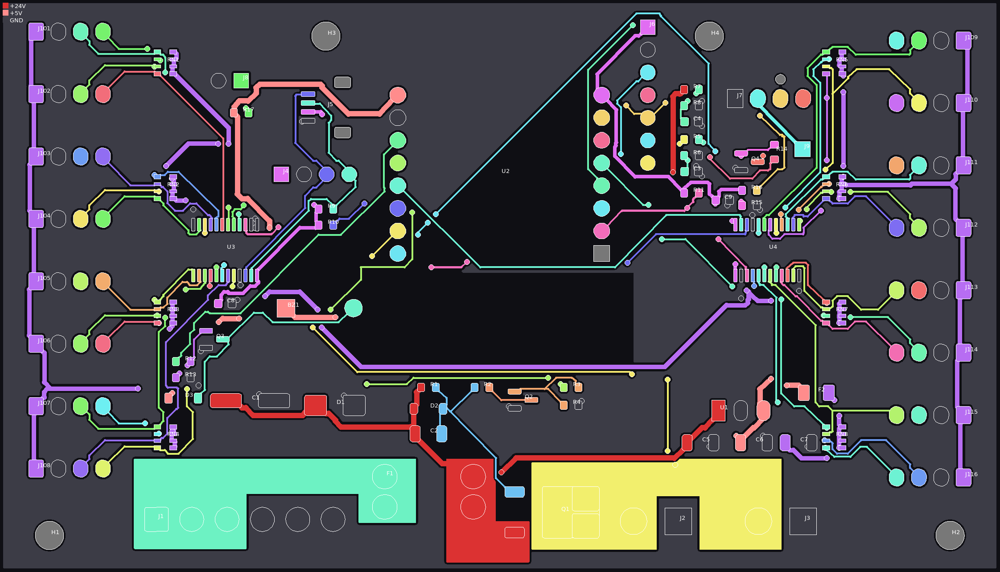
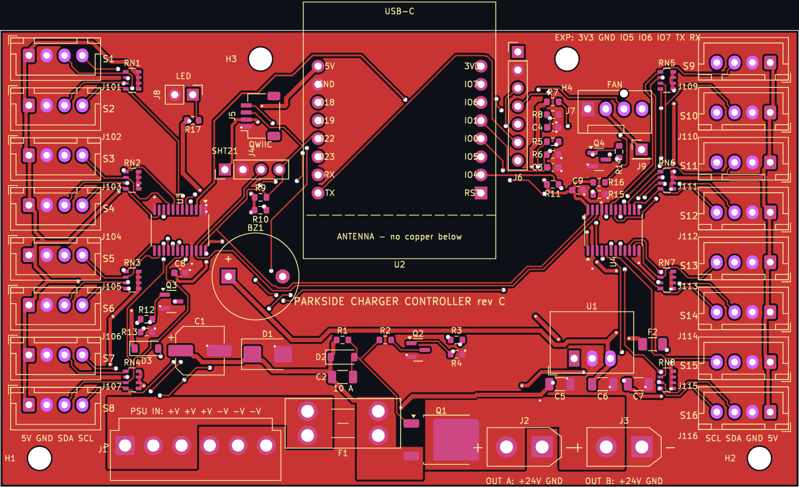

# Controller board (KiCad 7)

The controller board is the hub of the charger. It holds the **xyzroe ESP32-C6 D1** on pogo pins,
switches the 24 V for the slot chains, and runs one I²C channel to each of up to **16 slots**.
**110 × 100 mm, 4 layers** (In1/In2 = GND), all parts on one side.

| File | |
|---|---|
| `controller_board.kicad_pro / .kicad_sch / .kicad_pcb` | KiCad 7 project |
| `pcl.kicad_sym`, `pcl.pretty/` | Custom symbols and the ESP32-C6 D1 pogo footprint (holes from the module's own drill file) |
| `controller_board_schematic.pdf` | Schematic |
| `fab/controller_board_gerbers.zip`, `fab/*_bom.csv`, `fab/*_cpl.csv` | Gerbers, BOM and pick-and-place positions |
| `drc_report.txt` | KiCad DRC result |
| `tools/design.py`, `tools/layout.py` | Source: **edit these, then run `/usr/bin/python3 tools/build.py`** |

## Layout and connectors

| Where | What |
|---|---|
| Top edge, centre | **ESP32-C6 D1** on 2 × 1×8 pogo-pin headers (holes 1.1 mm, rows 22.86 mm apart). The USB-C faces the edge for flashing. The antenna points into the board, and the board has **no copper on any layer** below it |
| Top edge, left / right | **J4** SHT40 breakout (3V3 GND SCL SDA, 2.54 mm), **J5** Qwiic, **J6** expansion (3V3 GND IO5 IO6 IO7 TX RX) |
| Left / right edge | **J101–J108**: slots 1–8. **J109–J116**: slots 9–16. All are JST-XH 4-pin, `5V GND SDA SCL`, the same order as the slot board's J2, so cables are wired 1:1 |
| Bottom edge | **J1** 24 V from the PSU → **10 A mini blade fuse** → TVS → AOD4185 bus switch (soft start, GPIO19) → **J2 OUT A** and **J3 OUT B** (two slot daisy chains). Then the **TSR 1-2450** 5 V regulator and a 0.5 A PTC for the slot 5 V rail |
| Middle | 2 × TCA9548A (0x70 for slots 1–8, 0x71 for 9–16), rotated so each pin row faces its connectors, plus 8 × 4.7 kΩ pull-up arrays to 5V_SLOT and the buzzer |

The 24 V input, the switched 24 V, and the PSU-to-switch section are pours on both outer layers
(fuse limit 10 A).

## Assembly notes

- **Pogo pins:** solder two spring-loaded 1×8 pin headers (2.54 mm) into the U2 position, with
  the springs facing up. The ESP32-C6 D1 is then pressed onto them, USB towards the board edge.
  Hold it down with the lid, a strap, or a printed clamp. Alternatively, solder normal female
  headers.
- The silkscreen next to the pogo holes shows the module's pin names, so you can check the
  orientation before plugging it in.
- **TSR 1-2450:** fit it upright (SIP-3). The footprint also takes a RECOM R-78E5.0-1.0.

## Before ordering: check these

1. **Review the routing in KiCad.** The custom router routed this board automatically; DRC
   status is in `drc_report.txt`.
2. Check that your pogo headers fit 1.1 mm holes.
3. **Terminal block orientation:** check the wire-entry direction of J1–J3 in the 3D viewer. It
   should face the bottom edge, where the box has its cable notch.
