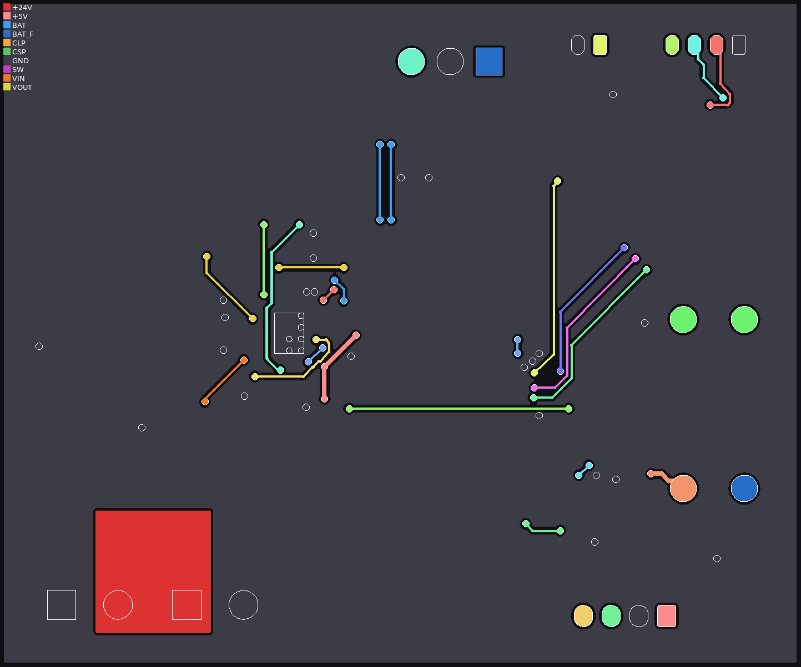

# Slot board (KiCad 9)

One per battery slot. It holds the LTC4162-LAD 5S Li-ion charger, the PCA9554 slot I/O
(presence switch, RGB LED, bleed resistor), and the I²C and 24 V connectors.
**72 × 47.5 mm, 4 layers** (In1/In2 = solid GND planes), all parts on the top side. A **10 mm
hole** at (40.5, 25) gives screwdriver access to the module's rear mounting screw.

| Top (parts side) with silkscreen | Bottom copper |
|---|---|
|  |  |
| **Inner layer 1** (In1) | **Inner layer 2** (In2) |
|  |  |

**Why 4 layers?** Two would work electrically, but the LTC4162 is a 1.5 MHz buck converter
switching several amps: a solid GND plane directly under the top layer keeps the hot loop small,
the current-sense lines quiet and the EMI low, and spreads the heat of the QFN, inductor and
MOSFETs. For small boards like this one, 4 layers cost only a little more than 2 at JLCPCB,
so it isn't worth the risk.

| File | |
|---|---|
| `slot_board.kicad_pro / .kicad_sch / .kicad_pcb` | KiCad 9 project: open with KiCad 9 or newer |
| `pcl.kicad_sym`, `sym-lib-table` | Custom symbols (LTC4162-LAD, PCA9554, Power33 MOSFET, ESD array, ...) |
| `slot_board_schematic.pdf` | Schematic |
| `fab/slot_board_gerbers.zip` | Gerbers + Excellon drill, ready to upload (e.g. JLCPCB: 4 layers, 1.6 mm, 1 oz) |
| `fab/slot_board_bom.csv`, `fab/slot_board_cpl.csv` | BOM and pick-and-place positions |
| `drc_report.txt` | KiCad DRC result |
| `tools/` | `design.py` + `layout.py`: **edit these, not the KiCad files**, then re-run `build.py` (see below) |

## Circuit

- The charger is the LTC4162-L datasheet (Rev A) typical application *"2-cell 3.2 A charger with
  PowerPath"*, set to **5 cells** (CELLS1 = CELLS0 = VCC2P5):
  - RT = 63.4 kΩ, which gives 1.5 MHz switching
  - L1 = 6.8 µH XAL6060
  - R_SNSB = R_SNSI = 10 mΩ (max 3.2 A charge / input)
  - INFET and BATFET are N-channel FDMC8327L
- **Input:** J1 (24 V IN, XT30PW-M male) and J6 (24 V OUT, XT30PW-F female) are right-angle XT30s
  sticking out of the rear edge, connected straight through so the slots **daisy-chain**. XT30s
  are polarised and gendered, so a chain cable only fits OUT → IN, the right way round. The pass-through copper is a
  pour on both outer layers (for the chain current), and GND passes through the two inner planes.
  Behind the connectors come a 5 A fuse, an SMBJ26A TVS and 47 µF of bulk capacitance.
- **Battery:** J3 (B+, B−, ID) goes through a mandatory 5 A fuse F2. The pack charges directly on
  B+/B−.
- **Pack BMS signal (ID contact):** 10 kΩ pull-up to 5 V (R15, like the Parkside charger), RC
  filter 100 kΩ / 4.7 µF (R16/C15) against the pack's short releases, TLV7031 comparator U4 at
  4.55 V (R17/R18) → PCA9554 IO6. High = released = BMS fault / deep discharge / no pack.
- **Thermistor:** the LTC4162 reads RT1, a 10 kΩ NTC (B 3380) at the front edge next to the
  battery contacts, with NTCBIAS 10 kΩ 0.1 %. The pack's own NTC is in series with its BMS
  transistor and pulsed, so it is not used.
- **I²C:** J2 (JST-XH 4: 5V, GND, SDA, SCL) has 100 Ω series resistors and a PESD5V0S2UT.
  LTC4162 @0x68 and PCA9554 @0x20 share the bus. The slot bus runs at 5 V; the TCA9548A on the
  controller shifts the level.
- **PCA9554:**
  - IO0: presence switch (J4)
  - IO1–3: common-cathode RGB LED (J5), with 560/270/270 Ω
  - IO4: bleed MOSFET Q3, which switches 2 × 100 Ω / 2 W (about 0.1 A) across the battery
  - IO5: SMBALERT

## Layout

The layout follows the LTC4162 datasheet's *PCB Layout Considerations*:
- The VOUT bypass capacitors C3/C4 sit directly at pins 27/28 → 23/24. SW (pins 25/26) leaves
  between their pads straight into L1, which keeps the hot loop minimal.
- **Kelvin traces:** CLP/CLN go to the RSNSI pads, and CSP/CSN/BATSENS+ go to the RSNSB pads.
- The INTVCC, VCC2P5 and VOUTA capacitors sit next to their pins. Every GND pad has its own via
  to the planes, and the exposed pad has 9 thermal vias.
- The input parts (TVS, bulk capacitor, fuse) sit in the left column next to the input FET, so
  the 24 V terminals and the I²C connector are as far forward as possible.
- The pack-ID circuit (R15–R18, C15, C16, comparator U4) sits in the front-left corner next to
  J3's ID terminal, so the ID line from the pack is short; only the comparator's logic output
  crosses the board to the PCA9554.
- The bleed resistors lie flat in the right half, away from the IC. Mount them 2–3 mm above the
  board.
- The **screwdriver hole** (board cutout, copper kept 0.5 mm away on all layers) sits between the
  charger and the PCA9554. It must stay aligned with `pcb_hole` in the 3D model.
- The board's long edges ride in the card guides of the printed bay, so parts keep 2 mm away
  from them.

**DRC:** no errors or unconnected items. What remains are 5 silkscreen cosmetics, which the fab
house clips at the pads, and `lib_footprint_issues` warnings. Those appear only because the
generator runs without the global library table; KiCad's GUI doesn't show them.

## Regenerating

```bash
cd tools
/usr/bin/python3 build.py          # schematic + netlist check, PCB (route, fill, DRC), fab files, renders
/usr/bin/python3 build.py sch      # only the schematic + netlist check
```

`design.py` is the single source of truth for parts and nets. `layout.py` holds the placement,
pour shapes, routing priorities, silkscreen and schematic sheet positions. The generator itself
is shared with the controller board in `../kicadgen/`. It needs KiCad 9 (`kicad-cli` and the
`pcbnew` Python module) with the standard KiCad 9 footprint and symbol libraries, so the
footprints in the board match the libraries KiCad 9 checks them against.

## Before ordering: check these

1. **FDMC8327L footprint:** it uses KiCad's `VSON-8_3.3x3.3mm_P0.65mm_NexFET` (the same
   S-S-S-G / drain-pad pinout as Power33). Compare it with the Onsemi land pattern, or pick a
   MOSFET specified for that footprint.
2. **Connector orientation:** check in the 3D viewer that J3's wire entry faces the front edge
   (towards the contact block) and that the XT30 noses of J1/J6 stick out of the rear edge.
3. **Review the routing in KiCad:** a custom grid router routed this board automatically.
   Electrically it is DRC-clean, but a human pass is recommended, especially:
   - the comparator output (U4 → PCA9554 IO6) across the board
   - the I²C pair along the middle of the board
4. **First bring-up:** use a current-limited lab supply. See `docs/firmware.md`, *Bring-up checklist*.
