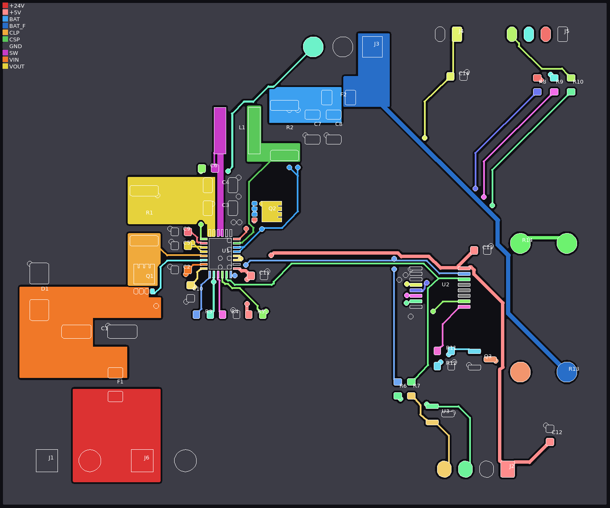
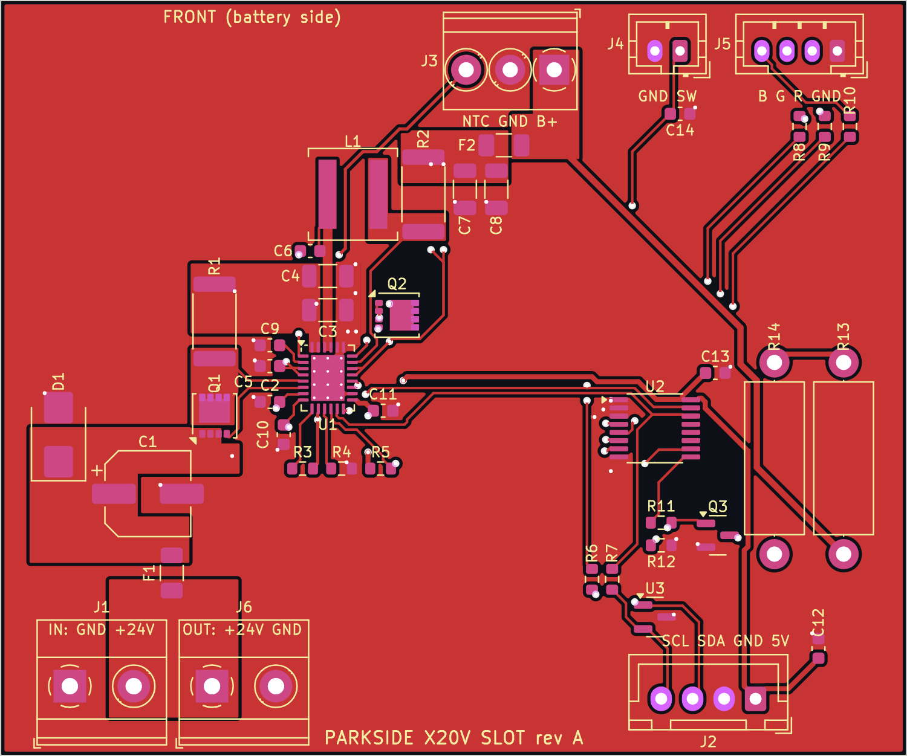

# Slot board (KiCad 7)

One per battery slot. It holds the LTC4162-LAD 5S Li-ion charger, the PCA9554 slot I/O
(presence switch, RGB LED, bleed resistor), and the I²C and 24 V connectors.
**72 × 60 mm, 4 layers** (In1/In2 = solid GND planes), all parts on the top side.




| File | |
|---|---|
| `slot_board.kicad_pro / .kicad_sch / .kicad_pcb` | KiCad 7 project: open with KiCad 7 or newer |
| `slot_board.kicad_sym`, `sym-lib-table` | Custom symbols (LTC4162-LAD, PCA9554, Power33 MOSFET, ESD array) |
| `slot_board_schematic.pdf` | Schematic |
| `fab/slot_board_gerbers.zip` | Gerbers + Excellon drill, ready to upload (e.g. JLCPCB: 4 layers, 1.6 mm, 1 oz) |
| `fab/slot_board_bom.csv`, `fab/slot_board_cpl.csv` | BOM and pick-and-place positions |
| `drc_report.txt` | KiCad DRC result |
| `tools/` | Generators: **edit these, not the KiCad files**, then re-run (see below) |

## Circuit

- The charger is the LTC4162-L datasheet (Rev A) typical application *"2-cell 3.2 A charger with
  PowerPath"*, set to **5 cells** (CELLS1 = CELLS0 = VCC2P5):
  - RT = 63.4 kΩ, which gives 1.5 MHz switching
  - L1 = 6.8 µH XAL6060
  - R_SNSB = R_SNSI = 10 mΩ (max 3.2 A charge / input)
  - INFET and BATFET are N-channel FDMC8327L
- **Input:** J1 (24 V IN) and J6 (24 V OUT) are 2-pole 5.08 mm screw terminals, connected
  straight through so the slots **daisy-chain**. The +24 V pins sit next to each other
  (`GND +24V | +24V GND`), so a chain jumper never crosses over. The pass-through copper is a
  pour on both outer layers (for the chain current), and GND passes through the two inner planes.
  Behind the terminals come a 5 A fuse, an SMBJ26A TVS and 47 µF of bulk capacitance.
- **Battery:** J3 (B+, B−, NTC) goes through a mandatory 5 A fuse F2. NTCBIAS is 10 kΩ 0.1 %.
- **I²C:** J2 (JST-XH 4: 5V, GND, SDA, SCL) has 100 Ω series resistors and a PESD5V0S2UT.
  LTC4162 @0x68 and PCA9554 @0x20 share the bus. The slot bus runs at 5 V; the TCA9548A on the
  controller shifts the level.
- **PCA9554:**
  - IO0: presence switch (J4)
  - IO1–3: common-cathode RGB LED (J5), with 560/270/270 Ω
  - IO4: bleed MOSFET Q3, which switches 2 × 100 Ω / 2 W (about 0.1 A) across the battery
  - IO5: SMBALERT

## Layout

The layout follows the LTC4162 datasheet's *PCB Layout Considerations*:
- The VOUT bypass capacitors C3/C4 sit directly at pins 27/28 → 23/24. SW (pins 25/26) leaves
  between their pads straight into L1, which keeps the hot loop minimal.
- **Kelvin traces:** CLP/CLN go to the RSNSI pads, and CSP/CSN/BATSENS+ go to the RSNSB pads.
- The INTVCC, VCC2P5 and VOUTA capacitors sit next to their pins. Every GND pad has its own via
  to the planes, and the exposed pad has 9 thermal vias.
- The bleed resistors are at the opposite corner from the IC. Mount them 2–3 mm above the board.
- The board's long edges ride in the card guides of the printed bay, so parts keep 2 mm away
  from them.

**DRC:** no errors or unconnected items. What remains are 5 silkscreen cosmetics, which the fab
house clips at the pads, and `lib_footprint_issues` warnings. Those appear only because the
generator runs without the global library table; KiCad's GUI doesn't show them.

## Regenerating

```bash
cd tools
python3 gen_schematic.py .. && python3 gen_project.py ..
kicad-cli sch export netlist -o /tmp/s.net ../slot_board.kicad_sch && python3 check_netlist.py /tmp/s.net
/usr/bin/python3 gen_pcb.py ..        # placement, pours, maze router, zone fill, DRC (~1 min)
/usr/bin/python3 gen_fab.py ..        # PCB-vs-design check, gerbers, drill, CPL, BOM, schematic PDF
/usr/bin/python3 render_pcb.py ../slot_board.kicad_pcb ../img
```

`design.py` is the single source of truth for parts and nets. `gen_pcb.py` holds placement,
pour shapes and routing order. It needs the `pcbnew` Python module that comes with KiCad 7.

## Before ordering: check these

1. **FDMC8327L footprint:** it uses KiCad's `VSON-8_3.3x3.3mm_P0.65mm_NexFET` (the same
   S-S-S-G / drain-pad pinout as Power33). Compare it with the Onsemi land pattern, or pick a
   MOSFET specified for that footprint.
2. **Terminal block orientation:** check which way the wire-entry side of J1/J6/J3 faces in the
   3D viewer, and that it suits how the board slides into the bay.
3. **Review the routing in KiCad:** a custom grid router routed this board automatically.
   Electrically it is DRC-clean, but a human pass is recommended, especially:
   - the long NTC trace from J3 to U1
   - the I²C pair along the middle of the board
4. **First bring-up:** use a current-limited lab supply. See `docs/firmware.md`, *Bring-up checklist*.
